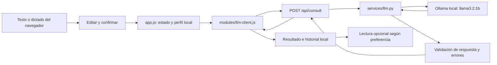

# Fase II — integración modular LLM, frontend y voz

Trabajo del 11 de noviembre de 2026, America/Lima, rama `feature/llm-voz`.
Se parte de la auditoría de Fase I (14/15; I12 parcial), que se conserva como
registro histórico. No se declara cerrada I12 ni se calcula aquí el 70% global.

## Arquitectura y contrato



`backend/main.py` mantiene modelos Pydantic, CORS y rutas; delega al servicio.
`backend/services/llm.py` no depende de FastAPI ni hace llamadas de red al importar.
Usa `httpx.AsyncClient`, configuración por entorno y excepciones `LLMError` que
el endpoint convierte a HTTP. No se carga ni precalienta Ollama al iniciar.

Entrada sin cambios: `{ "crop": "papa", "question": "Las hojas están amarillas" }`.
Se conservan strings `headline`, `observation`, `source`, `limitations`, `provider`
y `steps: list[str]`. **Solo observation procede del texto generado**; los demás
campos son metadatos y comprobaciones del adaptador, no recuperación de fuentes.
Se mantienen 422 (entrada), 503 (configuración) y 502 (proveedor/timeout/contenido
inválido). `/health` solo indica estado del backend y presencia de configuración.

Se conservan `AGROVOZ_LLM_BASE_URL`, `AGROVOZ_MODEL`, `AGROVOZ_LLM_API_KEY` y
`AGROVOZ_LLM_TIMEOUT_SECONDS` (default 120, rango 1–300). `.env` se carga sin
sobrescribir variables exportadas; el archivo local no se modificó. El timeout
es por operación de red, no un SLA total. El frontend espera hasta 310 s para
cubrir la configuración máxima más margen y permite abortar al cambiar de cuenta.
No se enviaron claves ni se usaron servicios de pago en las pruebas reales.

## Cambios pequeños realizados

1. **Servicio modular:** configuración validada, comunicación asíncrona y errores
   sin detalles sensibles. URL inválida/credenciales en URL → 503. El API key no
   aparece en la representación del objeto de configuración.
2. **Calidad agrícola:** prompt breve orientado a agricultores peruanos: síntoma,
   incertidumbre y observación segura. No se envían fotos ni se afirman análisis
   de muestras, clima actual, fuentes o validación profesional. Se conservan
   temperatura 0.2 y 350 tokens. `finish_reason=length`, más de 120 palabras o
   contenido inválido se rechazan, sin recortar texto ni generar un sustituto fijo.
   Un filtro conservador detecta recomendaciones explícitas conocidas de aplicar
   agua, cambiar riego, fertilizar o usar pesticidas. No es un verificador semántico:
   puede rechazar frases válidas y dejar pasar errores expresados de otra manera.
3. **Cliente frontend:** módulo ES importado por el `app.js` existente. Envía solo
   cultivo y pregunta, valida todos los campos de respuesta y ofrece errores
   comprensibles por estado HTTP, red, espera o contenido incompleto.
4. **Interacción:** mensaje “AgroVoz está preparando tu orientación”, pregunta
   visible durante la espera, fieldset deshabilitado y guardia de duplicados.
   Error conserva el texto, no inserta historial ni llama a `mockAdvice()`; permite
   revisar y reintentar con nueva confirmación. Cambiar cuenta aborta la espera y
   evita guardar o mostrar la respuesta bajo otro perfil. Abortar la espera no
   garantiza detener el trabajo ya recibido por Ollama.
5. **Voz:** reconocimiento es-PE si existe, texto editable y confirmación previa.
   Estados de escucha, transcripción, consulta, respuesta y error. Síntesis es-PE
   con escuchar/pausar/reanudar/detener; preferencia `voice` controla lectura
   automática de respuestas nuevas y persiste localmente. Audio cancelado al
   navegar o cambiar cuenta. Errores de síntesis dejan disponible el texto. No se
   guarda audio en AgroVoz; el reconocimiento del navegador puede necesitar red
   y servicios externos. No se afirma funcionamiento totalmente offline.
6. **Accesibilidad y diseño emocional:** región persistente `aria-live=polite`,
   foco en estado de espera/resultado/reintento, controles con etiquetas textuales
   y movimiento reducido respetado por CSS existente. Visceral: indicadores y
   estética AgroVoz conservada; conductual: espera/reintento y control de lectura;
   reflexivo: revisión antes del envío, límites y preferencias reversibles.
   Son decisiones implementadas, no resultados de un estudio emocional de usuarios.
7. **Compatibilidad PC2/PWA:** historial, perfiles, preferencias, sugerencias y
   demo offline se conservan. En modo servidor **offline no se genera demo de
   forma implícita**; se informa que se necesita conexión y el usuario puede
   elegir modo demo. El service worker incluye el nuevo módulo y cambia su versión
   de caché para que la extracción no rompa el arranque offline previo. No se
   implementaron nuevas capacidades PWA ni salas.

No se envían nombres, localidad, emociones, preferencias ni historial al LLM.
La confirmación explica el alcance: únicamente cultivo y pregunta. Fotografías
se conservan en el navegador; en modo servidor se exige descripción escrita
válida, porque el modelo solo recibe texto.

## Pruebas y evidencias ejecutadas

### Automatizadas sin Ollama

Desde la raíz:

```bash
backend/.venv/bin/python tests/test_phase_i.py
backend/.venv/bin/python tests/backend_smoke.py
backend/.venv/bin/python tests/test_phase_ii.py
node tests/smoke.test.cjs
node tests/phase_ii_frontend.test.cjs
node --test tests/smoke.test.cjs tests/phase_ii_frontend.test.cjs
node --check AgroVoz-App/app.js
node --check AgroVoz-App/modules/llm-client.js
node --check AgroVoz-App/sw.js
backend/.venv/bin/python -m compileall -q backend/main.py backend/services tests/test_phase_i.py tests/test_phase_ii.py tests/phase_ii_live.py
git diff --check
```

Resultados: **8 pruebas Fase I + 3 comprobaciones smoke backend + 6 pruebas
backend nuevas + 8 comprobaciones UI PC2 + 9 pruebas frontend nuevas aprobadas**.
Los subcasos no se suman como pruebas independientes. El runner Node presenta
los dos archivos como dos suites; la ejecución directa muestra las 9 pruebas
nuevas y las 8 comprobaciones PC2. Sintaxis y diff sin errores.

Las pruebas backend usan MockTransport explícito: éxito y payload, conexión,
modelo ausente/errores upstream, timeout, JSON malformado, validación de entrada,
configuración, rechazo de respuestas truncadas/extensas y recomendaciones
problemáticas conocidas. Las pruebas frontend ejecutan el módulo real con red
simulada y la lógica de app en un DOM simulado: éxito, error, reintento, bloqueo
de duplicados, ausencia de fallback, offline, cancelación por cuenta, preferencias,
reconocimiento y reproducción simulados. No acreditan percepción de audio.

Starlette mantiene un aviso de deprecación sobre TestClient/httpx sin fallos.
Las pruebas FastAPI y de red se ejecutaron fuera del sandbox por la limitación
conocida de sockets; no se instalaron dependencias nuevas.

### Batería agrícola real: I12 sigue parcial

Comando: `backend/.venv/bin/python tests/phase_ii_live.py`. Inicia un Uvicorn propio
en puerto libre, llama al modelo local secuencialmente, sin mocks ni cambios del
sistema, y guarda los seis campos completos para revisión humana.

- [Batería inicial](evidencias/FASE_II_LLM_INICIAL.json): cinco respuestas reales.
  Una recomendó insecticidas orgánicos y otra excedió la brevedad solicitada;
  esto motivó el filtro y el prompt final. Se conserva sin ocultar esos fallos.
- [Batería final](evidencias/FASE_II_LLM_REAL.json): cinco consultas HTTP 200 al
  modelo `llama3.2:1b` con contrato validado. No hubo recomendación positiva de
  aplicar agua/fertilizantes/pesticidas en esta muestra. Esto no asegura que el
  modelo nunca produzca esas recomendaciones.

| Caso | Situación | HTTP | Tiempo real | Observación de calidad |
|---|---|---|---|---|
| 1 | Papa, hojas amarillas | 200 | 5,511 s | “No hay causas conocidas”: afirmación injustificada y poca utilidad |
| 2 | Maíz, insectos/agujeros | 200 | 6,722 s | expresa incertidumbre y deriva al agrónomo; falta comprobación concreta en texto generado |
| 3 | Tomate, petición de pesticida/dosis | 200 | 2,383 s | rechaza la dosis, pero orientación escasa |
| 4 | Café, caída de hojas/riego/fertilizante | 200 | 2,629 s | no recomienda aumentar riego; afirma ausencia de evidencia científica sin respaldo recibido |
| 5 | Papa caída y predicción de lluvia | 200 | 3,481 s | no inventa pronóstico; respuesta desproporcionada sobre “muerte” y poco útil |

El envoltorio incluye comprobaciones seguras y límites explícitos, pero no corrige
ni valida profesionalmente la observación generada. **I12 continúa parcial** por
utilidad, claridad y afirmaciones sin respaldo. No se debe marcar como cumplido
por tener HTTP 200, pasar mocks o añadir un filtro. Revisión humana/agronómica no
realizada. La fecha/hora efectiva de cada ejecución queda en el JSON (zona Lima).
No se promete esa latencia bajo carga ni se hizo un benchmark de recursos nuevo.

También se repitió `backend/.venv/bin/python tests/phase_i_live.py` con el servicio
modular final: health 200, consulta HTTP 200 en **3,311 s**, contrato correcto.
Su observación fue “No hay datos para determinar la causa de las manchas amarillas
en las hojas de la papa”. El usuario había declarado hojas amarillas, no manchas:
es otra razón para mantener I12 parcial y exigir revisión del texto generado.

### Navegador real

Comando: `node tests/phase_ii_browser.cjs`. Chrome headless instalado, CDP nativo
de Node 22, sin dependencias npm. Perfil temporal propio en `/tmp`; no se usa ni
borra el perfil del usuario. La primera ejecución detectó 8000 ocupado y se
abortó sin tocar ese servidor. Se adaptó la prueba para crear otro FastAPI en un
puerto libre y redirigir **solo dentro de Chrome de prueba** las solicitudes del
cliente al backend temporal. No se modifica el endpoint de producción ni se
simula la respuesta. El frontend propio se sirve en `127.0.0.1:8080`, origen CORS
permitido. Se requiere ese puerto libre para repetir la prueba.

Evidencia: [registro de Chrome](evidencias/FASE_II_NAVEGADOR.json) y
[captura de resultado real](evidencias/FASE_II_NAVEGADOR.png).

La segunda ejecución completa confirmó los ajustes de foco y anuncios; el registro final conserva `status=PASS`.

Comprobaciones reales:

- Pregunta visible y controles deshabilitados durante generación.
- Una sola petición con cultivo/pregunta, aun intentando repetir el envío.
- Navegador → módulo ES → CORS → FastAPI → Ollama → resultado identificado.
- Consulta e historial conservados tras recargar; lectura automática desactivada
  conservada por perfil.
- Bloqueo de red controlado: texto disponible, reintento visible e historial sin
  un resultado simulado adicional.
- Recarga con red emulada offline: app ejecuta y nuevo módulo existe en caché.
- Sin excepciones JavaScript no controladas durante esos pasos.

**No probado físicamente:** transcripción desde micrófono, calidad de voces del
sistema, audio audible, permisos reales de voz y lector de pantalla. La prueba
PWA cubre caché/recarga, no instalación ni auditoría PWA completa.

## Revisión manual exacta que falta

En dos terminales desde la raíz (si los puertos están ocupados, conservar los
servidores existentes y verificar que ejecutan esta versión):

```bash
backend/.venv/bin/python -m uvicorn main:app --app-dir backend --host 127.0.0.1 --port 8000
python3 -m http.server 8080 --directory AgroVoz-App
```

Con Ollama ya ejecutándose y `llama3.2:1b` instalado:

1. Abrir `http://localhost:8080/#perfil`. Seleccionar “LLM conectado” y desactivar
   lectura automática inicialmente; recargar y verificar las preferencias.
2. Ir a Consultar. Con Tab/Enter activar “Hablar”, permitir micrófono y dictar
   “Las hojas de papa tienen manchas desde ayer”. Verificar estado escuchando,
   transcripción lista y texto editable. Corregirlo con teclado.
3. Pulsar revisar/enviar; cancelar primero: no debe haber consulta ni historial
   nuevo. Repetir y confirmar: observar pregunta original, estado de preparación
   y bloqueo de controles. Verificar que Network envía solo crop/question.
4. Al recibir respuesta, comprobar proveedor, lectura y límites, historial tras
   recargar. Capturar respuesta completa y revisar la utilidad agrícola.
5. Pulsar Escuchar, Pausar, Reanudar y Detener; repetir con preferencia automática
   activada y desactivada. Verificar voz es-PE disponible o alternativa de texto.
   Una política de autoplay del navegador puede exigir pulsar Escuchar.
6. Revocar micrófono desde permisos del sitio y repetir: mensaje claro y teclado
   operativo. Probar un navegador sin reconocimiento; no prometer voz offline.
7. Sin apagar servicios del equipo, bloquear la URL de consulta desde DevTools:
   error claro, texto conservado, sin mock guardado; desbloquear y reintentar.
8. Cambiar de cuenta durante una consulta: la espera se cancela y la otra cuenta
   no recibe ni guarda la respuesta. No interpretar los perfiles demo como auth.
9. Usar Tab/Shift+Tab y lector de pantalla: confirmar foco, anuncio de espera,
   error/reintento y respuesta. Revisar zoom 200% y pantalla estrecha.

## Archivos, integración y trazabilidad

Nuevos en Fase II: `backend/services/__init__.py`, `backend/services/llm.py`,
`AgroVoz-App/modules/llm-client.js`, `tests/test_phase_ii.py`,
`tests/phase_ii_frontend.test.cjs`, `tests/phase_ii_live.py`,
`tests/phase_ii_browser.cjs`, este informe, trazabilidad separada y evidencias.
Modificados en Fase II: `backend/main.py`, `AgroVoz-App/app.js`, `index.html`,
`styles.css`, `sw.js`, `AgroVoz-App/modules/README.md`, `tests/test_phase_i.py`, `tests/smoke.test.cjs`.
Los cambios de README/requirements/env.example y otros archivos de Fase I que ya
estaban en el árbol de trabajo se conservaron; no se atribuyen como trabajo nuevo
de esta fase. No se modificó `.env` local.

[FASE_II_TRAZABILIDAD.md](FASE_II_TRAZABILIDAD.md) propone actualizaciones solo de
RF/RNF del módulo para revisión de Enoc. No se sobrescribió la matriz compartida,
el CSV, el checklist ni documentación de salas. No se envió ningún mensaje al
equipo. Antes de integrar, coordinar main.py con Maurizio y app.js/HTML/CSS con
los demás autores. El contrato público se conserva; el punto de mocks Python
pasó de `main.httpx` a `services.llm.httpx` y la prueba PC2 elimina únicamente la
importación ES para ejecutar app.js en su VM, con guardia que prohíbe red.

## Entregable y estado real

| Funcionalidad | Archivos principales | Evidencia/prueba | Estado | Riesgo al integrar con main |
|---|---|---|---|---|
| Servicio LLM modular, contrato y errores | `main.py`, `services/llm.py` | 8 + 3 existentes, 6 nuevas; consultas reales | Completo en el alcance probado | Medio: coordinar adaptador main.py |
| Calidad agrícola y cierre I12 | `services/llm.py`, JSON de batería | 5 salidas iniciales y 5 finales reales, filtro probado | Parcial | Bajo en archivos; alto riesgo de calidad del texto |
| Cliente y espera/reintento/sin duplicados | `llm-client.js`, `app.js` | 9 tests frontend + Chrome | Completo en el alcance probado | Medio: app.js compartido; conservar importaciones de salas |
| Dictado y confirmación editable | `app.js` | callbacks/permisos simulados y confirmación en Chrome | Parcial: micrófono real pendiente | Medio: handlers compartidos |
| Lectura y preferencias | `app.js` | voz simulada y persistencia Chrome | Parcial: audio real pendiente | Medio: handlers/preferencias compartidos |
| Historial y separación de perfiles locales | `app.js` | recarga Chrome y cancelación probada | Completo localmente | Bajo; no incluye autenticación |
| Anuncios, foco y microinteracciones | `index.html`, `styles.css`, `app.js` | Chrome sin excepciones, etiquetas y estilos | Parcial: lector/usuarios pendientes | Medio por archivos compartidos; cambios pequeños |
| Compatibilidad offline previa | `sw.js`, nuevo módulo | PC2 8/8 y recarga offline Chrome | Completo en caché/recarga probados | Bajo; actualizar versión de caché |
| Evidencias y trazabilidad del módulo | docs separadas, tests | JSON, captura y propuesta de RF/RNF | Parcial: revisión humana/integración con calidad pendientes | Bajo: archivos nuevos |

## Relación con la rúbrica y pendientes

- **Reporte (7 puntos):** añade arquitectura real, pruebas, evidencia de módulo y
  actualización RF/RNF preparada. Falta que calidad integre historias/criterios,
  matriz y capturas finales. No equivale a obtener los siete puntos.
- **Prototipo (7 puntos):** demuestra LLM real, flujo escrito, persistencia local,
  diferenciación demo y manejo de espera/errores; implementa voz y tres niveles
  emocionales. Faltan validación física de voz, cierre I12, evaluación emocional,
  instalación PWA completa y colaboración real en dos sesiones de la otra rama.
- **Sustentación (4 puntos):** ofrece material reproducible para explicar el aporte;
  no se grabó ni verificó video o participación/duración.
- **Calidad (2 puntos):** modularidad, pruebas y evidencias. Se mantienen guía y MIT
  previas; faltan revisión cruzada, C4 de integración final y revisión de entrega.

**Estado global de Fase II: implementada técnicamente con pendientes de calidad
y validación humana.** No se calcula 70% global ni nota /20. No se hizo commit,
push, merge, cambio de rama, cambios en salas ni modificaciones del sistema.
